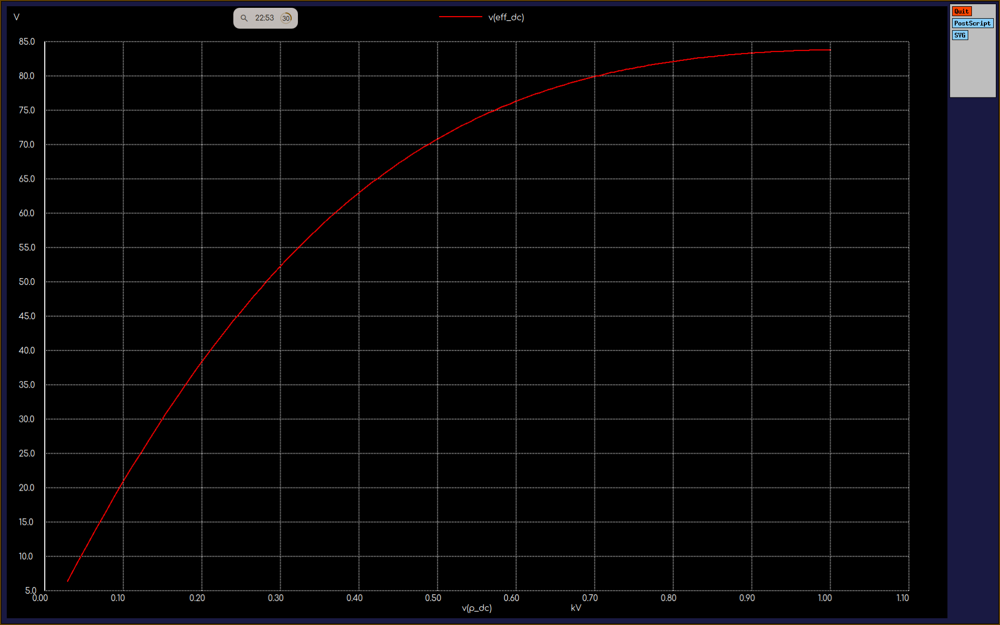
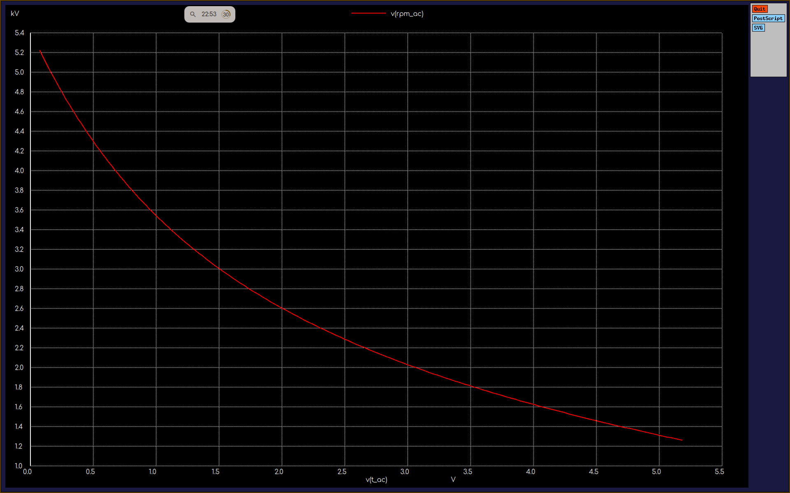
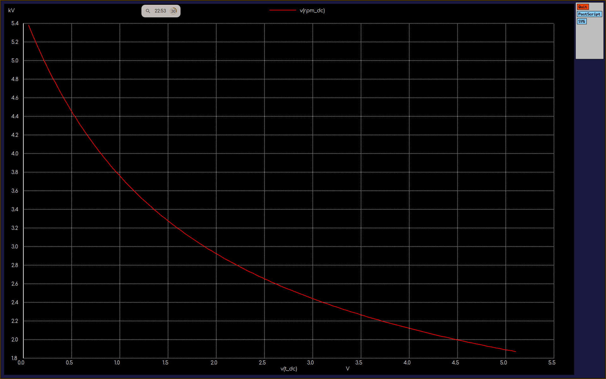
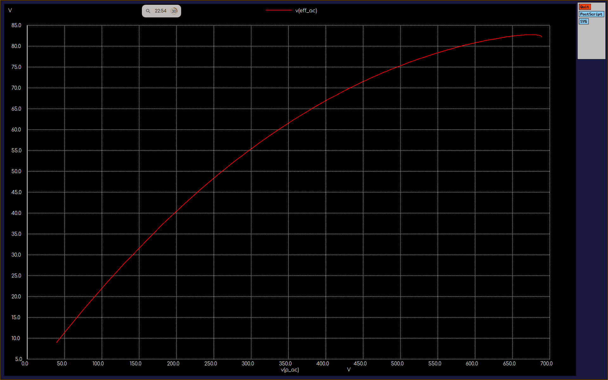
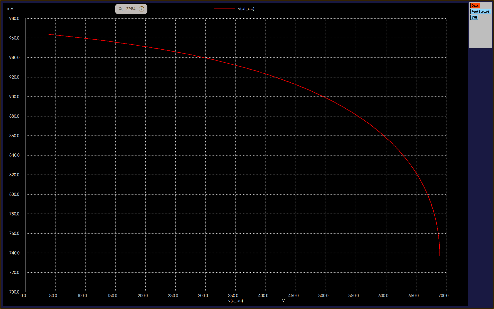

# Universal Motor Performance Curves

ngspice behavioral model of a series-wound universal motor, run on 50 Hz AC and on pure DC.

**Assumed motor data (not measured):** 230 V, 1 HP, 4 A, 2500 rpm. Series resistance 5 ohm, series inductance 0.1 H, brush drop 2 V, torque constant 0.1986, friction coefficient 1.25e-3.

## Plots
| DC | AC (50 Hz) |
|---|---|
|  |  |
|  |  |
| |  |

Reading the plots: ngspice labels behavioral quantities as volts, so "V" on the efficiency axes means percent, and "kV" on the speed axes means thousands of rpm.

## Run
    ngspice universal_motor_curves.cir

## Files
| File | What it is |
|---|---|
| `universal_motor_curves.cir` | Current-sweep model giving speed, torque, output power, efficiency and (AC) power factor |
| `plots/` | Saved ngspice plot screenshots |

## Author
Aayush, EEE @ NIT Goa
